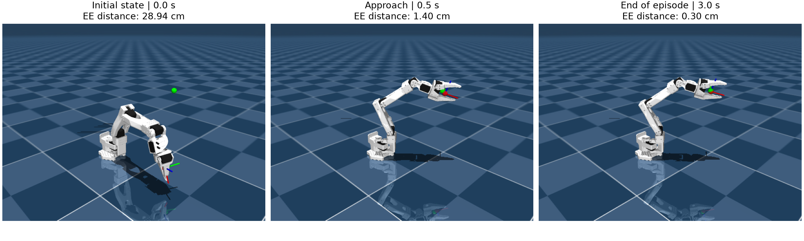
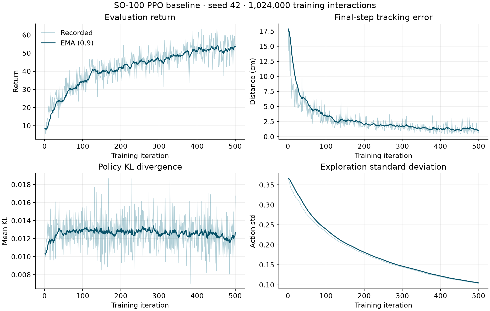
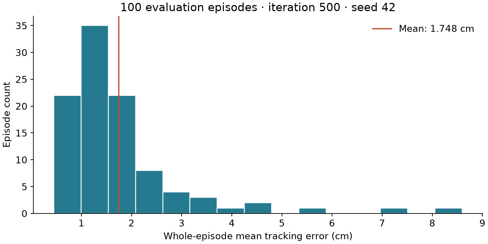

# SO-100 PPO: learning to reach in MuJoCo

The goal of this project was to train a reinforcement-learning policy to move
a simulated robot arm's end effector to a randomly placed target and settle near
it. PPO learns from interaction rewards, without expert action demonstrations
or a predefined path to follow.



*One real MuJoCo rollout of the trained policy: initial state, approach, and end
of the three-second episode. The green sphere marks the target. Frames use the
iteration-500 checkpoint, seed 42, first episode, and deterministic CPU inference.
Distances describe this illustrative episode; aggregate results appear below.*

The learned behavior is **closed-loop target-reaching control**. Every 0.1 s,
the actor receives the current robot/target observation and issues six joint
position commands. MuJoCo's position actuators execute those commands. Repeating
this process produces the motion trajectory; the policy does not explicitly
compute a complete path in advance or track a prescribed time-varying trajectory.

This independent study builds on the
[ETH Zürich Robot Learning assignment](https://github.com/tenvinc/ethz-course-2026/tree/main/hw4_reinforcement_learning).

After **1,024,000 training interactions**, the final policy achieved a mean
whole-episode end-effector tracking error of **1.75 cm across 100 evaluation
episodes**, with mean return **53.08 ± 10.93**. This is one training seed and
one evaluation seed, rather than a multi-seed benchmark.



## The task

The robot starts near a default joint configuration and moves its end effector
toward a randomly placed target. Each episode lasts three simulated seconds
(30 control steps). The task is target reaching; grasping and pick-and-place
are future extensions.

| Component | Definition |
|---|---|
| Observation | 19 values: six joint positions, EE position, EE quaternion, target position, and target-minus-EE position |
| Action | Six normalized absolute joint-position commands in `[-1, 1]` |
| Actor | Gaussian policy with observation-dependent mean and learned, observation-independent standard deviation |
| Critic | Scalar state-value prediction |
| Reward | Distance-based reward, proximity bonuses, and a joint-velocity penalty |
| Control | 10 Hz; 50 MuJoCo simulation steps per action |

An action of zero commands the midpoint of a joint's limits. During training,
the Gaussian sample is saved for likelihood calculations; a clipped copy is
sent to the environment. Evaluation uses the clipped Gaussian mean.

## Implementation

The completed PPO components are in `exercises/ex3_ppo.py`: action selection,
old-to-new Gaussian KL divergence, clipped surrogate loss, clipped value loss,
entropy regularization, and the combined actor/critic optimization step.

The course supplies the simulator, networks, rollout buffer with GAE, and
training/evaluation scaffolding. Shared network and buffer modules retain
additional course utilities. See [sources and attribution](THIRD_PARTY.md) and
the [original assignment](docs/course-assignment.md).

## Setup

Tested on Ubuntu with Python 3.12 and an NVIDIA GeForce RTX 4060 Laptop GPU.
Training automatically selects CUDA when available and otherwise uses CPU.

```bash
git clone https://github.com/yiannisls/s0101-ppo.git
cd s0101-ppo
uv venv --python 3.12
source .venv/bin/activate
uv pip install -r requirements.txt
```

Alternatively, use `python3.12 -m venv .venv` and
`python -m pip install -r requirements.txt` after activation.
The baseline package versions are recorded in
[environment.json](results/baseline/environment.json); the requirements specify
compatible ranges, rather than an exact cross-platform lockfile.

```bash
python -m unittest discover -s tests -v
```

## Train and evaluate

```bash
python scripts/train_ppo.py
```

The supplied baseline uses seed 42, 500 iterations, 2,048 rollout steps per
iteration, 10 epochs per rollout, and minibatches of 1,024. The actor and critic
use hidden widths `[256, 128, 128]`. See
`exercises/ex3_ppo_config.py` for the full configuration. Checkpoints are saved
every 50 iterations under `logs/ppo/<run>/`.

In a second activated terminal:

```bash
tensorboard --logdir logs/ppo
```

For a checkpoint from your own training run:

```bash
python scripts/eval_ppo.py \
  --model_path logs/ppo/<run>/iter_500.pt \
  --num_eval_episodes 100

python scripts/eval_ppo.py \
  --model_path logs/ppo/<run>/iter_500.pt --play
```

Replace `<run>` with the directory created by training. Omitting `--model_path`
selects the latest run's highest-iteration checkpoint. GUI playback requires a
graphical desktop. The evaluation seed comes from `PPO_PARAMETERS["seed"]`.

Checkpoints and raw event logs are excluded from Git. A fresh clone must train
a policy before evaluating it. Published results refer to the retained local
iteration-500 checkpoint, identified by its SHA-256 in the result metadata.

## Baseline results

| Metric | 100-episode evaluation |
|---|---:|
| Mean return ± episode standard deviation | 53.080 ± 10.928 |
| Mean whole-episode tracking error | 1.748 cm |
| Standard deviation of episode-mean error | 1.282 cm |
| Best / worst episode-mean error | 0.451 / 8.596 cm |
| Episode length | 30 steps |



Training-time TensorBoard evaluation averages the **final-step** tracking error
over five episodes. The standalone evaluation averages error over **all steps**
in each episode and then over episodes. These metrics should not be compared as
if they measure the same thing.

The learner observed fast approach, transient oscillation while approaching,
and settling near the target in GUI playback. Oscillation was not quantified.
The final checkpoint was retained as a baseline without a checkpoint-selection
sweep. The earlier 20-episode evaluation is a prefix of the 100-episode run.

See the [experiment log](docs/experiment-log.md),
[full evaluation output](results/baseline/eval_100.txt), and
[result metadata](results/baseline/summary.json). No success-rate threshold is
defined for this reaching task, so these results are not a pick-and-place
success rate.

## Reproduce the simulation images

With a trained checkpoint available, run:

```bash
python scripts/render_policy.py --model_path logs/ppo/<run>/iter_500.pt
```

This renders the first episode with seed 42 at 0.0, 0.5, and 3.0 seconds, using
CPU inference. Images and capture metadata are saved in `media/`. The script
defaults to EGL for offscreen rendering on Linux; an appropriate OpenGL backend
is required. The capture metadata records the instantaneous error at each frame.
